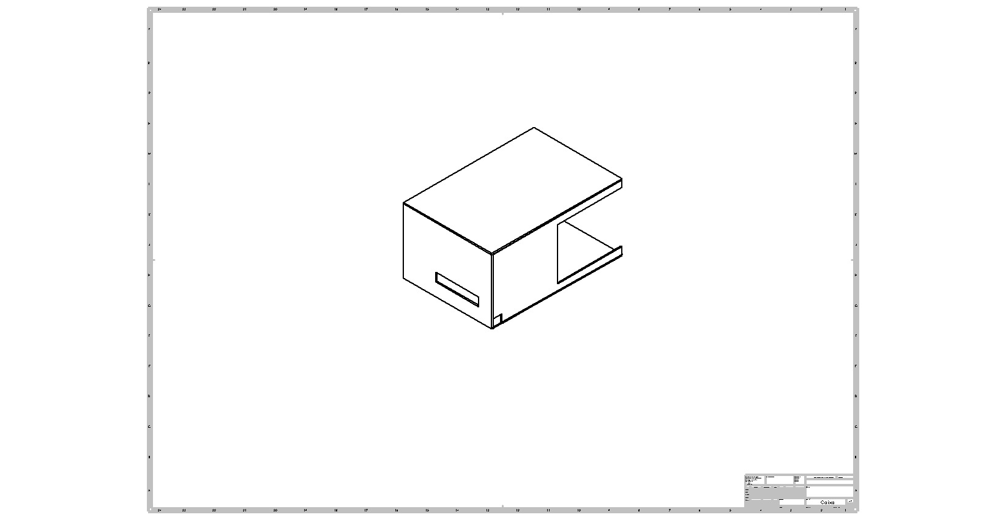

# Bancada — configuração fixa

> Registro da montagem física (etapa E2). Não alterar sem refazer a calibração (E3).

| Item | Configuração |
|---|---|
| Câmera | Celular via DroidCam (PC de teste) |
| Fixação | Suporte físico fixo, câmera apontada para baixo |
| Altura da câmera | **303 mm** (lente → tecido) |
| Fundo | Tecido corvin preto, fosco |
| Caixa | Caixa escura fechada (bloqueia a luz ambiente). Projeto em SolidWorks |
| Iluminação | _a definir_ |
| Foco | _a travar_ |
| Exposição / balanço de branco | _a travar_ |
| Resolução | _a definir_ |

## Caixa escura

